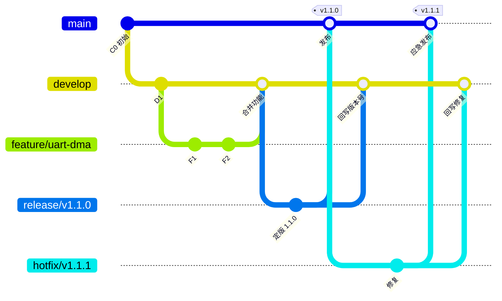

# 嵌入式项目 Git 协作与版本管理规范

> 适用对象：嵌入式固件与驱动仓库的全体开发、审核与维护人员
> 文档性质：团队协作规范，通用模板。接入新项目时，替换其中的仓库地址与审核负责人即可
> 关联标准：分支模型基于 Git Flow 精简而来，版本号遵循[语义化版本 2.0.0](https://semver.org/lang/zh-CN/)，变更日志遵循 [Keep a Changelog](https://keepachangelog.com/zh-CN/1.1.0/)

## 1 分支模型

仓库长期保留两条主分支，其余分支均为临时分支，用完即删：

| 分支 | 切出自 | 合并去向 | 生命周期 | 用途 |
|------|--------|----------|----------|------|
| `main` | — | — | 永久 | 发布主干，只接受合并，每个发布打 tag |
| `develop` | main | — | 永久 | 日常开发集成分支 |
| `feature/<模块>-<简述>` | develop | develop | 临时 | 单个功能开发，合完即删 |
| `release/vX.Y.Z` | develop | main + develop | 临时 | 发布准备，冻结期只修缺陷 |
| `hotfix/vX.Y.Z` | main | main + develop | 临时 | 线上固件应急修复 |

分支命名使用小写字母与连字符，例如 `feature/uart-dma`、`feature/sensor-calib`。release 与 hotfix 分支名中的版本号即本次发布的版本号。



两条铁律：

1. `main` 与 `develop` 受分支保护，任何人不允许直接 push，改动一律通过 Pull Request 进入
2. release 与 hotfix 合入 main 后必须同时合回 develop，否则修复会在下个版本中丢失

## 2 提交一个功能

前置条件：已克隆仓库并有写权限；本地 `develop` 已与远程同步（`git checkout develop && git pull`）。

1. 从 develop 切出功能分支：

   ```bash
   git checkout develop
   git checkout -b feature/uart-dma
   ```

2. 开发并提交，提交消息遵循 `type(scope): subject` 格式：

   ```bash
   git add src/uart_dma.c
   git commit -m "feat(uart): 新增 DMA 收发通道"
   ```

   常用 type：`feat` 新功能、`fix` 缺陷修复、`chore` 工程配置、`docs` 文档、`refactor` 重构

3. 推送分支到远程：

   ```bash
   git push -u origin feature/uart-dma
   ```

4. 发起 Pull Request，目标分支选择 `develop`，按仓库 PR 模板填写变更说明与实机测试记录：

   ```bash
   gh pr create --base develop --fill
   ```

5. 等待审核。收到修改意见后直接在该分支继续提交并 push，PR 自动更新

6. 审核通过被合并后，同步本地并删除功能分支：

   ```bash
   git checkout develop && git pull
   git branch -d feature/uart-dma
   git push origin --delete feature/uart-dma
   ```

预期结果：PR 以 merge commit 方式进入 develop，功能分支被删除，PR 页面显示 Merged。

常见问题：功能分支误从 main 切出时，先 `git rebase --onto develop main` 调整基线，再强制推送（仅 feature 分支允许 force push，使用 `--force-with-lease`）。

## 3 发布一个版本

前置条件：develop 上的功能已集齐并通过自测；由 Maintainer 执行本节操作。

1. 从 develop 切出发布分支：

   ```bash
   git checkout develop
   git checkout -b release/v1.1.0
   ```

2. 定版：将 `VERSION` 文件改为 `1.1.0`，把 CHANGELOG 的 `[Unreleased]` 区块整理为 `[1.1.0] - 日期`，提交：

   ```bash
   git commit -am "chore(release): 定版 v1.1.0"
   ```

3. 冻结期测试：此阶段只允许缺陷修复进入，不允许新功能。每个修复单独提交

4. 回归通过后发起两个 PR：`release/v1.1.0 → main` 和 `release/v1.1.0 → develop`，审核通过后按顺序合并：

   ```bash
   git checkout main
   git merge --no-ff release/v1.1.0
   git tag -a v1.1.0 -m "固件 v1.1.0"
   git checkout develop
   git merge --no-ff release/v1.1.0
   git branch -d release/v1.1.0
   git push origin main develop --tags
   ```

5. 在 GitHub Releases 页面基于 tag `v1.1.0` 创建 Release，附件上传编译产物（`.hex`/`.bin`/`.elf`），正文粘贴 CHANGELOG 对应区块

预期结果：main 上出现 annotated tag `v1.1.0`，GitHub Releases 有对应条目并附固件文件，develop 版本号与 main 一致。

常见问题：冻结期临时想加功能时，该功能只能推迟到下一版本；发布分支一旦定版，内容只减不增（除缺陷修复）。

## 4 修复线上固件问题

前置条件：问题出现在已发布的 tag 版本上且可复现；修复需经 Reviewer 确认。

1. 从 main 的最新 tag 切出修复分支，版本号为当前版本修订号加一：

   ```bash
   git checkout -b hotfix/v1.1.1 main
   ```

2. 修复缺陷并补充 CHANGELOG 的 `Fixed` 条目与 `VERSION` 文件，提交：

   ```bash
   git commit -am "fix(uart): 修复波特率寄存器按36MHz主频误算"
   ```

3. 发起 PR（`hotfix/v1.1.1 → main`），在描述中附问题现象、根因分析与实机验证记录

4. 合并到 main 后打 tag，再合回 develop，最后删除分支：

   ```bash
   git checkout main
   git merge --no-ff hotfix/v1.1.1
   git tag -a v1.1.1 -m "固件 v1.1.1 应急修复版"
   git checkout develop
   git merge --no-ff hotfix/v1.1.1
   git branch -d hotfix/v1.1.1
   git push origin main develop --tags
   ```

预期结果：线上问题以 `v1.1.1` 重新发布，修复同时存在于 main 与 develop。

常见问题：只合入 main 而忘记合回 develop，会导致下一版本发布时修复丢失。PR 未同时开两个方向的，Maintainer 在合并前补齐。

## 5 审核与合并

### 5.1 发起方

PR 描述回答三个问题：改了什么、为什么改、如何验证。涉及驱动与硬件交互的改动，必须附实机测试记录（测试板型号、固件版本、测试项与结果）。

### 5.2 审核方

Review 前先读 PR 描述与关联需求，再逐文件审阅。嵌入式代码的审核重点：

| 关注点 | 检查内容 |
|--------|----------|
| 寄存器与时钟配置 | 值的来源是否与数据手册一致，主频假设是否正确 |
| 中断与时序 | 临界区保护、中断优先级、阻塞时长 |
| 内存 | 栈用量、缓冲区边界、DMA 与 Cache 一致性 |
| 可追溯性 | 版本号与 CHANGELOG 是否同步，实测记录是否完整 |

审核操作：

```bash
gh pr review <PR号> --comment          # 仅评论
gh pr review <PR号> --request-changes  # 要求修改，阻塞合并
gh pr review <PR号> --approve          # 批准
```

### 5.3 合并方式

统一使用 Create a merge commit（命令行等价 `git merge --no-ff`），保留功能分支的提交边界，便于按功能回溯与整体 revert。

### 5.4 冲突处理

1. 在功能分支本地执行 `git fetch && git rebase origin/develop`
2. 逐个解决冲突文件后 `git rebase --continue`
3. `git push --force-with-lease` 更新 PR

预期结果：PR 显示无冲突、状态变为可合并。

### 5.5 分支保护要求

由仓库管理员在 GitHub 仓库 Settings 中配置，`main` 与 `develop` 各建一条规则：

- Require a pull request before merging，Required approvals 为 1
- Dismiss stale approvals（有新提交时撤销已批准状态）
- Require review from Code Owners（配合 `.github/CODEOWNERS` 指派负责人）
- 禁止 force push，禁止删除分支

注意：GitHub 不允许自己批准自己的 PR。团队只有一人时，先用 Rulesets 的 Bypass list 放行自己，第二位成员加入后再取消。

## 6 版本管理规则

### 6.1 版本号语义

版本号格式为 `主版本.次版本.修订号`：

| 变更性质 | 版本动作 | 示例 |
|----------|----------|------|
| 通信协议、升级接口、API 不兼容 | 主版本加一 | v1.9.0 → v2.0.0 |
| 新增功能或驱动 | 次版本加一 | v1.1.0 → v1.2.0 |
| 缺陷修复 | 修订号加一 | v1.1.0 → v1.1.1 |

多硬件版本共存的仓库，可在 CHANGELOG 与 Release 说明中标注适配硬件版本，例如 v2.0.0 起仅支持 HW Rev.B 以上板卡。

### 6.2 版本三同步

以下三处必须一致，CI 可加一致性校验：

1. tag 名：`vX.Y.Z`
2. `VERSION` 文件内容：`X.Y.Z`
3. `CHANGELOG.md` 对应版本条目

固件编译时注入版本号，运行时可通过命令行或升级协议查询，保证现场固件可追溯：

```bash
CFLAGS += -DFW_VERSION=\"$(cat VERSION)\"
```

## 7 仓库配置清单

接入新项目时逐项配置：

- [ ] 创建 `develop` 分支并推送远程：`git push -u origin develop`
- [ ] `main` 与 `develop` 配置分支保护（见 5.5）
- [ ] 根目录放置 `VERSION` 与 `CHANGELOG.md`
- [ ] `.gitignore` 覆盖编译产物与各 IDE 工程生成文件（Keil 的 `*.uvguix.*`、IAR 的 `settings/`、CubeIDE 的 `.project` 等）
- [ ] 配置 `.github/PULL_REQUEST_TEMPLATE.md`，含实机测试记录区块
- [ ] 配置 `.github/CODEOWNERS`，按模块指派审核负责人

## 8 命令速查

```bash
# 同步与切分支
git checkout develop && git pull
git checkout -b feature/xxx develop

# 推送与 PR
git push -u origin feature/xxx
gh pr create --base develop --fill
gh pr checks <PR号>

# 审核与合并
gh pr review <PR号> --approve
gh pr merge <PR号> --merge --delete-branch

# 发布与 tag
git tag -a vX.Y.Z -m "说明"
git push origin main develop --tags

# 撤销一次已合并的 PR（整体回退）
git revert -m 1 <merge提交号>
```

## 9 常见问题处理

| 问题 | 处理方式 |
|------|----------|
| PR 提示冲突 | 按第 5.4 节 rebase 解决后 `--force-with-lease` 推送 |
| 功能误合入 main | `git revert -m 1 <merge提交号>` 生成反向提交，再走 PR 审核 |
| tag 打错且未发布 Release | `git tag -d vX.Y.Z` 与 `git push origin :refs/tags/vX.Y.Z` 删除后重打；已随 Release 发出的固件 tag 不可删除，只能追加新版本 |
| 编译产物误入库 | `git rm --cached <文件>` 后补 `.gitignore`，走 PR 提交 |
| 提交消息不合规范 | 合并前 `git rebase -i origin/develop` 修正（仅 feature 分支） |
